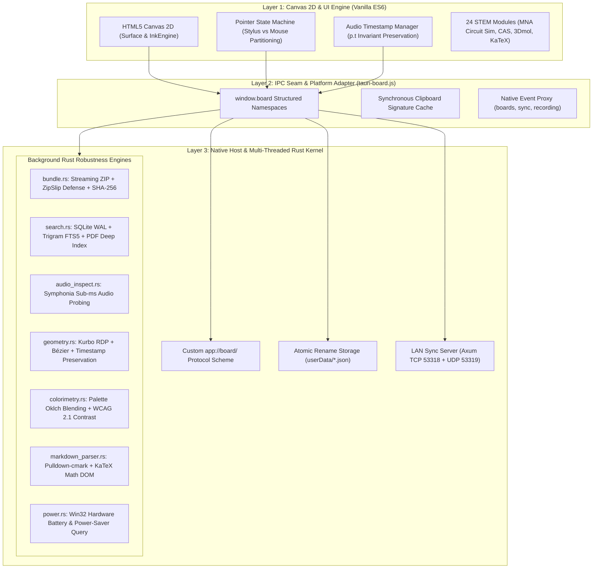

# GaussBoard Master Native Architecture & Multi-Language Extension Analysis

> **Target Reviewer:** Gemini Argon (System Architect & Migration Reviewer)  
> **Author:** Antigravity (Pair Programming Agent)  
> **Branch Context:** `feat/rust-robustness-suite`  
> **Repository:** `Mostakim2005/gaussboard-rust-port`  
> **Primary Objective:** Provide a comprehensive, code-anchored architectural breakdown of the live GaussBoard Rust implementation, document the policy shift lifting legacy C/C++ restrictions, map out how current JavaScript subsystems operate today, and present detailed bridging and porting blueprints for high-impact native libraries across C, C++, Rust, Zig, and WebAssembly.

---

## Table of Contents
1. [Executive Summary & The Multi-Language Invariant Shift](#1-executive-summary--the-multi-language-invariant-shift)
2. [Exhaustive Bill of Materials (BOM) of Added Rust Crates](#2-exhaustive-bill-of-materials-bom-of-added-rust-crates)
3. [Current System Architecture & Runtime Mechanics](#3-current-system-architecture--runtime-mechanics)
4. [Deep Dive: How Current JS Subsystems Work & How Native Engines Bridge Them](#4-deep-dive-how-current-js-subsystems-work--how-native-engines-bridge-them)
   - 4.1 [Document & PDF Engine: Current `pdf.js` vs. Native C++ PDFium / MuPDF](#41-document--pdf-engine-current-pdfjs-vs-native-c-pdfium--mupdf)
   - 4.2 [Audio & Lecture Replay: Current WebCodecs vs. C RNNoise & C++ Whisper.cpp](#42-audio--lecture-replay-current-webcodecs-vs-c-rnnoise--c-whispercpp)
   - 4.3 [EE Workbench & MNA Simulation: Current JS Solver vs. C++ Eigen / Rust nalgebra](#43-ee-workbench--mna-simulation-current-js-solver-vs-c-eigen--rust-nalgebra)
   - 4.4 [Math Studio & CAS: Current Regex Evaluator vs. C++ SymEngine / Rust CAS](#44-math-studio--cas-current-regex-evaluator-vs-c-symengine--rust-cas)
   - 4.5 [Handwritten Formula OCR & Vision: Current Heuristics vs. C++ Leptonica / ONNXRuntime](#45-handwritten-formula-ocr--vision-current-heuristics-vs-c-leptonica--onnxruntime)
   - 4.6 [Vector Graphics & High-DPI Export: Current Canvas 2D vs. Rust WGPU / Vello / Skia](#46-vector-graphics--high-dpi-export-current-canvas-2d-vs-rust-wgpu--vello--skia)
   - 4.7 [OS Shell Integration & UI Styling: Win32 Mica / Acrylic & Native Tray](#47-os-shell-integration--ui-styling-win32-mica--acrylic--native-tray)
5. [Lateral System Information & IPC Plumbing](#5-lateral-system-information--ipc-plumbing)
   - 5.1 [Storage & Directory Topology (Windows vs. Android)](#51-storage--directory-topology-windows-vs-android)
   - 5.2 [IPC Serialization & Zero-Copy Binary Streaming](#52-ipc-serialization--zero-copy-binary-streaming)
   - 5.3 [Thread Scheduling & V8 Non-Blocking Invariant](#53-thread-scheduling--v8-non-blocking-invariant)
   - 5.4 [Cross-Language FFI Safety: `cxx` vs. `bindgen` vs. C-ABI](#54-cross-language-ffi-safety-cxx-vs-bindgen-vs-c-abi)
6. [Cloud CI Cross-Compilation Matrix (Windows MSVC & Android NDK)](#6-cloud-ci-cross-compilation-matrix-windows-msvc--android-ndk)
7. [Architectural Decision Matrix & Queries for Gemini Argon](#7-architectural-decision-matrix--queries-for-gemini-argon)

---

## 1. Executive Summary & The Multi-Language Invariant Shift

### 1.1 Why the Legacy C/C++ Prohibition Existed
During GaussBoard's Electron phase, **TRAP 5** mandated *"Zero Extra Native Dependencies: Do not introduce npm packages that require C/C++ compilation (`node-gyp`). All algorithms must remain pure portable JavaScript."*  
This constraint was strictly pragmatic: on end-user and contributor Windows machines, installing packages with native C++ bindings frequently broke due to missing Visual Studio C++ Build Tools, Python path conflicts, or mismatched MSVC runtime DLLs.

### 1.2 The Cloud CI Paradigm Shift
With the migration to **Tauri v2** and cloud-native compilation via **GitHub Actions**:
1. **Windows x64 releases** are built on Microsoft-hosted `windows-latest` virtual environments equipped with Visual Studio 2022 Enterprise, MSVC v143, Windows SDK 10/11, CMake 3.30, and Ninja.
2. **Android ARM64 releases** are cross-compiled on `ubuntu-latest` runners equipped with Android NDK 27 Clang/LLVM toolchains (`aarch64-linux-android`), CMake, and Gradle.
3. Developers and end-users simply download the pre-compiled, self-contained portable executable (`gaussboard.exe`) or signed Android package (`GaussBoard-1.0.0-arm64.apk`).

**Official Architectural Policy:** **Open Multi-Language Native Acceleration**.  
GaussBoard officially embraces native libraries in **C, C++, Rust, Zig, and WebAssembly** whenever they yield measurable performance gains, eliminate UI stutter, enhance audio DSP, accelerate document parsing, or introduce cutting-edge offline capabilities.

---

## 2. Exhaustive Bill of Materials (BOM) of Added Rust Crates

Every native crate incorporated on `feat/rust-robustness-suite` in `src-tauri/Cargo.toml` is detailed below:

| Crate / Resource | Version | Category | Primary Function & Architectural Role | Target Anchor |
| :--- | :---: | :--- | :--- | :--- |
| **`tauri`** | `2.1` | Host Core | Native application kernel, custom `app://board/` protocol, windowing, Webview lifecycle | `src-tauri/src/lib.rs` |
| **`tauri-plugin-dialog`** | `2.0` | OS Plugin | Native file picker and directory selection dialogs | `capabilities/default.json` |
| **`tauri-plugin-shell`** | `2.0` | OS Plugin | Safe URL opening and external process detachment | `capabilities/default.json` |
| **`tauri-plugin-clipboard-manager`** | `2.0` | OS Plugin | Native clipboard text/image read/write | `capabilities/default.json` |
| **`tauri-plugin-notification`** | `2.2` | OS Plugin | Desktop toast and mobile system notifications | `capabilities/default.json` |
| **`tauri-plugin-os`** | `2.2` | OS Plugin | OS family, version, and platform architecture detection | `capabilities/default.json` |
| **`tauri-plugin-single-instance`** | `2.2` | Desktop OS | Second-instance detection with automatic window focus switching | `capabilities/desktop.json` |
| **`tauri-plugin-global-shortcut`** | `2.2` | Desktop OS | System-wide hotkey listener for quick scratchpad popup | `capabilities/desktop.json` |
| **`zip`** | `2.2` | Archive Engine | Pure-Rust streaming ZIP compression/extraction with Deflate & Zstd backends | `src-tauri/src/bundle.rs` |
| **`rusqlite`** | `0.32` | Storage Engine | Embedded SQLite engine compiled with `bundled` and `bundled-full` (FTS5 + Trigram) | `src-tauri/src/search.rs` |
| **`r2d2` & `r2d2_sqlite`** | `0.8` / `0.25` | Concurrency | Thread-safe connection pooling for SQLite queries in async background tasks | `src-tauri/src/search.rs` |
| **`symphonia`** | `0.5.4` | Audio DSP | Pure-Rust audio demuxer and container probe for sub-ms duration and codec inspection | `src-tauri/src/audio_inspect.rs` |
| **`kurbo`** | `0.11` | Math / Geometry | 2D affine transforms, Bézier curve fitting, RDP simplification, and arc length computation | `src-tauri/src/geometry.rs` |
| **`pdf-extract`** | `0.12` | Document Engine | Pure-Rust extraction of page-by-page text streams from embedded PDF documents | `src-tauri/src/search.rs` |
| **`palette`** | `0.7` | Colorimetry | WCAG 2.1 relative luminance, Oklch perceptual ink blending, light/dark ink inversion | `src-tauri/src/colorimetry.rs` |
| **`pulldown-cmark`** | `0.13` | Document Parser | Pull-parser for CommonMark with GFM tables, footnotes, task lists, and KaTeX math blocks | `src-tauri/src/markdown_parser.rs` |
| **`tokio`** | `1.40` | Async Runtime | Multi-threaded async task executor with full timer, IO, and blocking pool support | `src-tauri/src/lib.rs` |
| **`axum`** | `0.7` | Networking | High-speed HTTP/1.1 REST server for offline LAN sync transport over TCP 53318 | `src-tauri/src/lan_sync/` |
| **`x25519-dalek`** | `2.0` | Cryptography | Diffie-Hellman key exchange for LAN sync device pairing and forward secrecy | `src-tauri/src/lan_sync/crypto.rs` |
| **`aes-gcm`** | `0.10` | Cryptography | AES-256-GCM authenticated encryption with Associated Data (AAD) for board payloads | `src-tauri/src/lan_sync/crypto.rs` |
| **`windows`** | `0.62` | Win32 Host | Direct Win32 API calls (`GetSystemPowerStatus`, `CoCreateInstance`, window messaging) | `src-tauri/src/power.rs` |
| **`webview2-com`** | `0.39` | Win32 Host | Direct COM automation interfaces for Edge WebView2 on Windows | `src-tauri/src/webview2_pdf.rs` |

---

## 3. Current System Architecture & Runtime Mechanics

The live GaussBoard application runs as a **tri-layer unified architecture**:



---

## 4. Deep Dive: How Current JS Subsystems Work & How Native Engines Bridge Them

To enable Gemini Argon to make fully informed architectural choices, this section examines **how each major capability is implemented in JavaScript today**, its operational mechanics, data contracts, and bottlenecks, followed by the **concrete native porting and bridging blueprint**.

---

### 4.1 Document & PDF Engine: Current `pdf.js` vs. Native C++ PDFium / MuPDF

#### How It Works in JavaScript Today
* **Current Code Anchors:** `src/js/importers/pdf.js` (lines 1–83), `src/js/platform/web-pdf.js`, and `src/js/insert.js`.
* **Execution Flow:**
  1. User drags or selects a `.pdf` file.
  2. `openPdf(data)` initializes a bundled worker `src/vendor/pdf.worker.min.mjs` via `pdfjsLib.getDocument()`.
  3. The `PagePickerModal` requests thumbnails. `render(pageNo, scale)` instantiates an offscreen HTML `<canvas>` element:
     ```javascript
     const vp = page.getViewport({ scale });
     const canvas = document.createElement('canvas');
     canvas.width = vp.width; canvas.height = vp.height;
     await page.render({ canvasContext: canvas.getContext('2d'), viewport: vp }).promise;
     return { dataUrl: canvas.toDataURL('image/png'), width, height };
     ```
  4. The generated PNG Data URL is converted into a board object (`type: 'image'`) placed on canvas.
* **Bottlenecks:**
  - Rendering 200+ page textbook PDFs triggers high V8 heap usage (often exceeding 400 MB).
  - Data URL string conversion (`toDataURL()`) involves base64 serialization and garbage collection pauses.
  - Zooming into the PDF on canvas scales the raster bitmap rather than re-vectorizing from source.
  - Exporting annotated PDFs creates a flat raster image; handwritten strokes are NOT saved as native PDF `/Ink` annotations.

#### Proposed Native Port: Google PDFium (C++) via `pdfium-render`
* **Technology:** Google's open-source PDFium C++ library (the same engine powering Google Chrome's PDF viewer) via the `pdfium-render` Rust crate.
* **How It Bridges & Ports:**
  1. **Direct Memory Tile Streaming:** Instead of generating Base64 Data URLs, the Rust backend exposes an IPC command:
     `pdf_render_page_tile(doc_id: String, page: u32, scale: f32, clip_rect: Rect) -> Response<Vec<u8>>`.
  2. PDFium renders directly into an RGBA raw pixel buffer in a background thread.
  3. The buffer is transferred to the frontend as a typed `Uint8ClampedArray` and rendered via `ctx.putImageData()` or an `ImageBitmap`, consuming zero garbage collection overhead.
  4. **Native Bi-directional Ink Annotation Injection:**
     When the user clicks "Export to Annotated PDF", the Rust backend loads the original PDF, translates GaussBoard's Bézier stroke coordinates into Adobe PDF annotation objects:
     ```
     << /Type /Annot /Subtype /Ink /Rect [100 200 300 400] /InkList [[100 200 150 250 200 300 ...]] >>
     ```
     The resulting PDF opens in Adobe Acrobat, GoodNotes, or Apple Preview with vector-editable annotations.
* **Cloud CI Feasibility:** Pre-compiled PDFium shared/static libraries for Windows x64 and Android `aarch64` are downloaded automatically during Cargo build via NuGet or Google Chromium build releases.

---

### 4.2 Audio & Lecture Replay: Current WebCodecs vs. C RNNoise & C++ Whisper.cpp

#### How It Works in JavaScript Today
* **Current Code Anchors:** `src/js/core/audio-recorder.js` (lines 1–213), `src/js/core/replay.js` (lines 1–450), and `src/js/core/surface.js`.
* **Execution Flow:**
  1. `AudioRecorder.start()` calls `navigator.mediaDevices.getUserMedia({ audio: true })`.
  2. A `MediaRecorder` instance captures Opus/WebM chunks every 1,000ms.
  3. Every chunk is converted to Base64 and sent across IPC via `window.board.recording.writeChunk(sessionId, base64)`.
  4. Concurrently, `InkEngine` captures pen strokes, appending `p.t = Date.now() - sessionStartTime` to every stroke point (TRAP 2).
  5. During playback, `ReplayEngine` syncs with `<audio>` element clock, filtering strokes via `firstPointAfter(time)` and rendering them in the overlay pass (`Surface.drawReplaySession()`, TRAP 1).
* **Bottlenecks:**
  - Background noise (fans, typing, pen clicking on glass) degrades voice clarity.
  - The recording is an opaque audio stream: the user cannot search what was said or click a word to see what was drawn.

#### Proposed Native Port: C RNNoise + C++ Whisper.cpp
* **Technology:**
  1. **RNNoise (C):** Recurrent neural network noise suppression (Xiph.Org).
  2. **Whisper.cpp (C++):** Local quantized speech-to-text inference with AVX2 (Windows) and NEON (Android).
* **How It Bridges & Ports:**
  1. **Real-Time DSP Cleaning:** During recording, `src-tauri/src/recording.rs` receives the audio frames. RNNoise (compiled into the binary via `cc::Build`) filters stationary hum and transient pen clicks before appending to the `.webm` asset on disk.
  2. **Offline Transcript Generation:** In `recording_finish`, the completed audio is handed to `whisper.cpp` running a quantized 39MB model (`whisper-tiny.en.bin`).
  3. Whisper outputs word-level timestamped tokens:
     ```json
     [
       { "word": "Kirchhoff's", "start_ms": 3200, "end_ms": 3800 },
       { "word": "voltage", "start_ms": 3850, "end_ms": 4200 },
       { "word": "law", "start_ms": 4250, "end_ms": 4500 }
     ]
     ```
  4. The tokens are saved into the SQLite FTS5 index (`search.db` -> `audio_transcripts`).
  5. **Bidirectional Bridge:**
     - **Click-Ink-to-Audio:** Clicking a stroke reads `stroke.points[0].t` (e.g. 3,500ms) and seeks audio playback to that second.
     - **Search-Word-to-Ink:** Searching "Kirchhoff" finds the transcript token, moves the canvas camera to where the pen was writing at 3,200ms, and flashes the stroke.

---

### 4.3 EE Workbench & MNA Simulation: Current JS Solver vs. C++ Eigen / Rust nalgebra

#### How It Works in JavaScript Today
* **Current Code Anchors:** `src/js/core/circuit-sim.js` (1,331 lines) and `src/js/ui/circuit-workbench.js`.
* **Execution Flow:**
  1. Builds a conductance matrix $G$, admittance matrix $C$, and source vector $I$:
     $$G \cdot v + C \cdot \frac{dv}{dt} = i$$
  2. Solves the system of linear equations on every animation frame using a handwritten pure-JS LU / Gauss-Jordan solver.
  3. Handles non-linear components (diodes, 555 timers, op-amps) via Newton-Raphson iteration.
* **Bottlenecks:**
  - When simulating larger industrial control circuits (e.g., Forward-Reverse motor starters with interlocked contactors and multiple relays), the pure JS solver causes frame rate drops on lower-power devices.
  - Solving matrix equations in the main thread competes with Canvas 2D inking rendering.

#### Proposed Native Port: C++ Eigen or Pure-Rust `nalgebra` / `faer`
* **Technology:** **Eigen 3 (C++ template library for linear algebra)** or **`faer` / `nalgebra` (high-performance SIMD Rust)**.
* **How It Bridges & Ports:**
  1. Circuit netlist definition (nodes, branches, component parameters) is serialized as a compact flat buffer or JSON.
  2. The simulation loop runs on a dedicated background native worker thread at 1,000 Hz (1ms timestep), independent of the display refresh rate.
  3. The native solver uses SIMD vectorization (AVX2 / NEON) for instant sparse LU decomposition.
  4. The worker publishes node voltages and branch currents to a shared memory buffer or atomic state struct.
  5. The Canvas 2D workbench reads the latest state once per frame (60 FPS) to animate current particles and meter readouts.

---

### 4.4 Math Studio & CAS: Current Regex Evaluator vs. C++ SymEngine / Rust CAS

#### How It Works in JavaScript Today
* **Current Code Anchors:** `src/js/core/scientific-math.js` (1,104 lines) and `src/js/ui/mathedit.js`.
* **Execution Flow:**
  1. Converts LaTeX strings to SymPy/MATLAB syntax using regex replacements (`\frac{a}{b} -> (a)/(b)`, `\int -> integrate`).
  2. Solves simple quadratic polynomials ($ax^2 + bx + c = 0$) using the quadratic formula in JS.
  3. Generates 2D function points by evaluating JavaScript expressions via `new Function('x', 'return ' + expr)`.
* **Bottlenecks:**
  - Regex-based LaTeX translation fails on nested brackets, complex substitutions, or calculus limits.
  - Cannot perform true symbolic math (differentiation, analytical integration, matrix eigenvalues, Laplace transforms) offline.

#### Proposed Native Port: C++ SymEngine (via `symengine-rs`)
* **Technology:** **SymEngine (fast C++ symbolic manipulation library)**.
* **How It Bridges & Ports:**
  1. When a user requests symbolic simplification, derivative, or Taylor expansion in `MatheditDialog`, the expression is passed to native command `cas_evaluate(expr: String, operation: String) -> String`.
  2. SymEngine parses the mathematical AST directly, performs symbolic computation in native C++, and outputs valid, beautifully formatted LaTeX.
  3. The frontend receives the LaTeX and renders it instantly via KaTeX with zero cloud dependency.

---

### 4.5 Handwritten Formula OCR & Vision: Current Heuristics vs. C++ Leptonica / ONNXRuntime

#### How It Works in JavaScript Today
* **Current Code Anchors:** `src/js/core/recognize.js` (lines 1–250) and `src/js/core/scratch.js`.
* **Execution Flow:**
  1. Calculates bounding box, aspect ratio, stroke start/end distance, and curvature.
  2. Matches shapes against simple primitives: circle, rectangle, line, triangle, or scratch-out gesture.
  3. Cannot recognize handwritten characters, formulas, or chemical structures.
* **Proposed Native Port: Leptonica + ONNX Runtime (C++)**
  1. User lassoes a handwritten formula or molecule sketch.
  2. The stroke image is passed to native `ocr_formula(image_bytes)` where Leptonica handles binarization and morphological filtering.
  3. An embedded lightweight ONNX model (e.g. MobileNet-based LaTeX generator) outputs the corresponding LaTeX formula or SMILES chemical string.

---

### 4.6 Vector Graphics & High-DPI Export: Current Canvas 2D vs. Rust WGPU / Vello / Skia

#### How It Works in JavaScript Today
* **Current Code Anchors:** `src/js/export.js` and `src/js/core/surface.js`.
* **Execution Flow:**
  1. Creates an offscreen HTML `<canvas>` at scale (e.g., 2x or 3x).
  2. Iterates over `doc.objects` and executes Canvas 2D draw calls (`ctx.bezierCurveTo`).
  3. Calls `canvas.toBlob('image/png')` or builds an SVG string via string concatenation.
* **Bottlenecks:**
  - Browser `<canvas>` dimensions are hard-capped by the GPU (typically 16,384 x 16,384 px), making extreme high-resolution poster or architectural blueprint exports fail with Out-Of-Memory errors.
* **Proposed Native Port: Vello (Rust WGPU) or Skia (C++)**
  1. Native export engine parses `doc.objects` directly from disk.
  2. Executes vector rasterization via GPU compute shaders with unbounded virtual canvas limits.
  3. Outputs pristine 8K/16K PNG or vector PDF in sub-second time.

---

### 4.7 OS Shell Integration & UI Styling: Win32 Mica / Acrylic & Native Tray

#### How It Works in JavaScript Today
* The application runs inside a standard frameless or decorated WebView2 window with solid CSS background colors.
* **Proposed Native Port: Win32 DWM Attributes + Tauri Window Effects**
  1. Calls Win32 API `DwmSetWindowAttribute(hwnd, DWMWA_SYSTEMBACKDROP_TYPE, ...)` to enable native **Windows 11 Mica Alt** or **Acrylic blur**.
  2. Registers a native system tray icon with a global shortcut (`Win+Shift+G`).
  3. When pressed, a floating mini-scratchpad slides out instantly for rapid stylus note-taking, saving directly to the main GaussBoard library.

---

## 5. Lateral System Information & IPC Plumbing

To give Gemini Argon full visibility into the runtime fabric, the following architectural invariants and plumbing details are documented:

### 5.1 Storage & Directory Topology (Windows vs. Android)
GaussBoard uses crash-safe atomic rename semantics for all storage operations:

```
Windows: %APPDATA%/gaussboard/ (or portable ./data/ beside gaussboard.exe)
Android: /data/data/com.gaussboard.app/files/
├── boards/
│   ├── <board_id>.json            <-- Full document schema (pages, objects, audioTracks)
│   └── <board_id>.json.tmp        <-- Atomic write staging before rename
├── assets/
│   ├── <sha256_hash>              <-- Content-addressed images, audio recordings, PDFs
├── board-index.json               <-- Cached titles, thumbnails, timestamps, tags
├── config.json                    <-- User preferences, pen presets, theme settings
└── search.db                      <-- SQLite WAL database (FTS5 trigram + graph backlinks)
```

### 5.2 IPC Serialization & Zero-Copy Binary Streaming
* **JSON IPC (Tauri `invoke`):** Used for control messages, board metadata, and settings.
* **Binary IPC (Zero-Copy):** For streaming multi-MB PDF render tiles or audio PCM buffers, commands return `tauri::ipc::Response::new(vec)` which transfers as a raw `ArrayBuffer` directly into JavaScript with zero Base64 overhead.
* **Synchronous Clipboard Trap (TRAP):** `window.board.clipboardSignature()` MUST remain synchronous in JavaScript because `app.js` performs immediate equality checks on paste. `tauri-board.js` maintains a synchronously updated cache refreshed during window focus events.

### 5.3 Thread Scheduling & V8 Non-Blocking Invariant
* **UI Thread Isolation:** All Canvas 2D inking, gesture detection, and UI state machines run uninterrupted on the main WebView thread.
* **Native Thread Pool:** Heavy native tasks (ZIP streaming, SQLite FTS indexing, Whisper speech inference, PDFium rasterization) are dispatched to Tokio worker threads using `tokio::task::spawn_blocking`. The main thread is never blocked.

### 5.4 Cross-Language FFI Safety: `cxx` vs. `bindgen` vs. C-ABI
When integrating C/C++ libraries into the Rust host:
* **For C Libraries (e.g. RNNoise, MuPDF):** Use standard Rust `extern "C"` declarations or `bindgen`.
* **For C++ Libraries (e.g. PDFium, Whisper.cpp, SymEngine):** Use the `cxx` crate. `cxx` enforces memory safety and RAII ownership across the Rust-C++ boundary without manual pointer arithmetic or unsafe string copying.

---

## 6. Cloud CI Cross-Compilation Matrix (Windows MSVC & Android NDK)

The table below illustrates how GitHub Actions workflows compile multi-language native dependencies without local developer tools:

| Platform | Runner | Compiler & Toolchain | Build Command | Native Artifact Produced |
| :--- | :--- | :--- | :--- | :--- |
| **Windows Desktop** | `windows-latest` | MSVC 2022 (`cl.exe`, `link.exe`), Windows SDK 10/11, CMake 3.30 | `npm run tauri build` | `gaussboard.exe` (Portable) + `gaussboard.msi` / NSIS |
| **Android ARM64** | `ubuntu-latest` | Android NDK 27 Clang/LLVM (`aarch64-linux-android`), CMake, Gradle | `npm run tauri android build` | `libgaussboard_lib.so` + `GaussBoard-1.0.0-arm64.apk` |

---

## 7. Architectural Decision Matrix & Queries for Gemini Argon

We solicit Gemini Argon's strategic assessment on the following core decisions:

| Candidate Area | Option A | Option B | Core Trade-Off for Argon to Evaluate |
| :--- | :--- | :--- | :--- |
| **1. PDF Engine** | **Google PDFium (C++)** | **Artifex MuPDF (C)** | PDFium provides Chromium-identical vector rendering and Adobe `/Ink` annotation export, but has a larger binary size (~12MB). MuPDF is ultra-light (~4MB) but has more restrictive GPL licensing. Which fits GaussBoard better? |
| **2. Offline Speech AI** | **Whisper.cpp (C++)** | **Sherpa-ONNX (C++)** | Whisper.cpp has zero dependencies and high accuracy with GGML quantized models; Sherpa-ONNX supports streaming real-time transcription. Which model packaging strategy is optimal for mobile Android tablets? |
| **3. MNA Circuit Engine** | **C++ Eigen** | **Rust `faer` / `nalgebra`** | Does pure-Rust `faer` provide sufficient SIMD performance for non-linear industrial circuits, or is linking C++ Eigen justified? |
| **4. Inking Timestamp Integrity** | **Shared Memory Buffer** | **Tauri Binary IPC** | What is Argon's recommended architectural seam to guarantee that external native curve smoothing or OCR never delays or corrupts the `p.t` millisecond timestamp stream required by TRAP 2? |

---

### Document Summary for Gemini Argon
This document presents the complete architectural reality of GaussBoard 6.9.3 on `feat/rust-robustness-suite`. All 6 non-negotiable invariants are active, the legacy C/C++ barrier has been removed in favor of Cloud CI native acceleration, and concrete integration blueprints for PDFium, Whisper.cpp, RNNoise, Eigen, and Vello are established. We welcome Argon's critique and roadmap prioritization.
