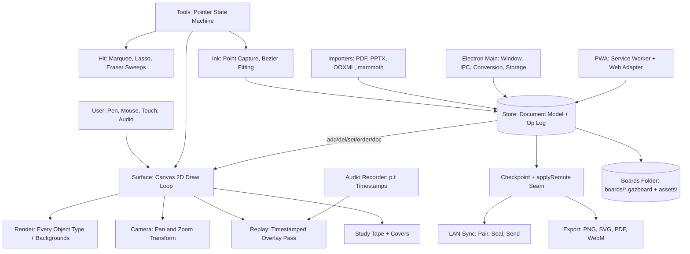
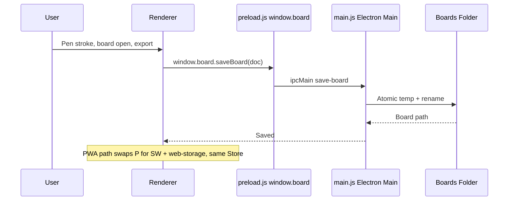
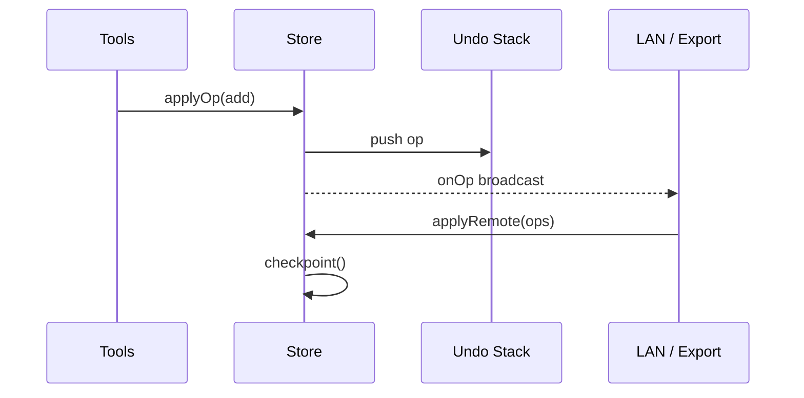
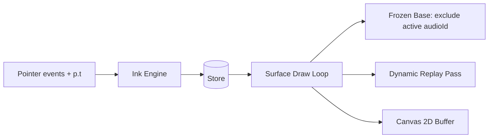
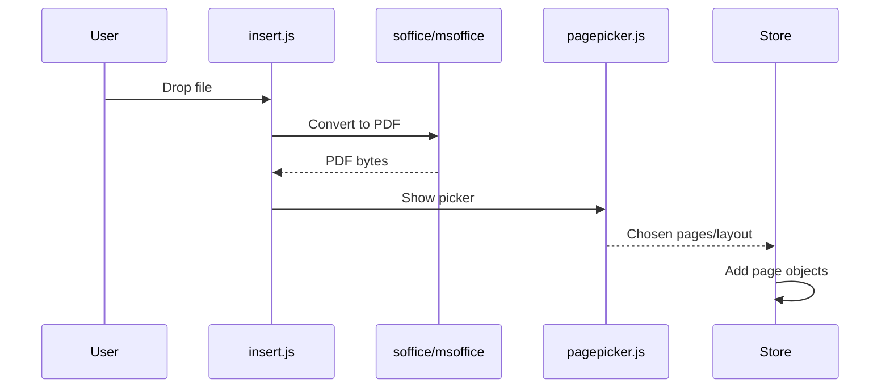
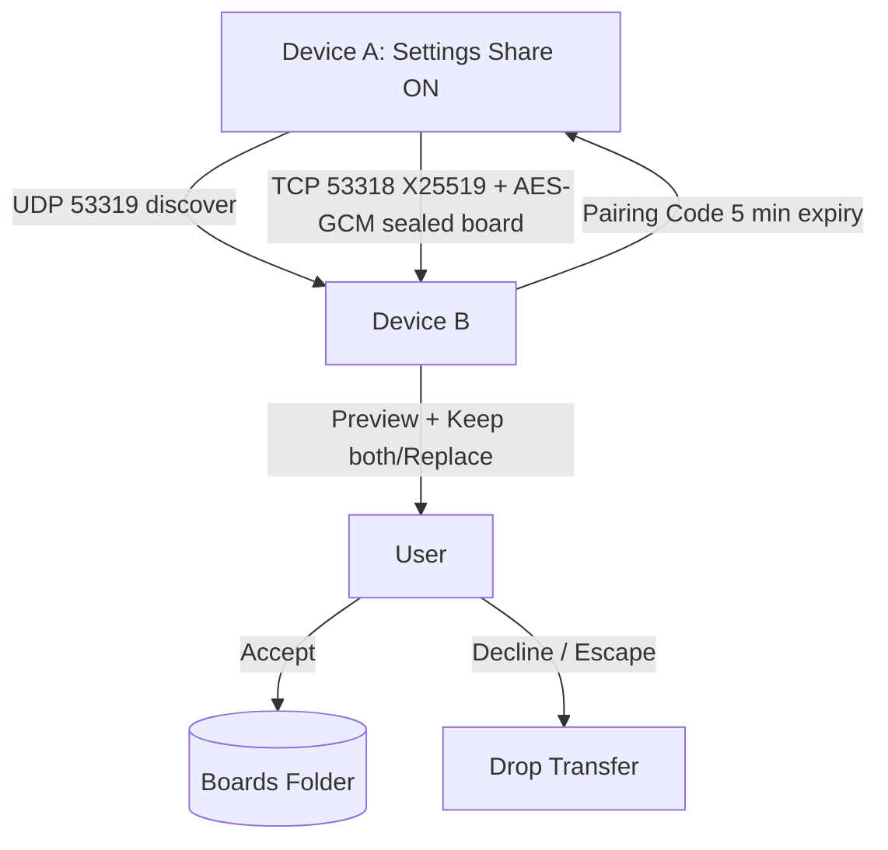
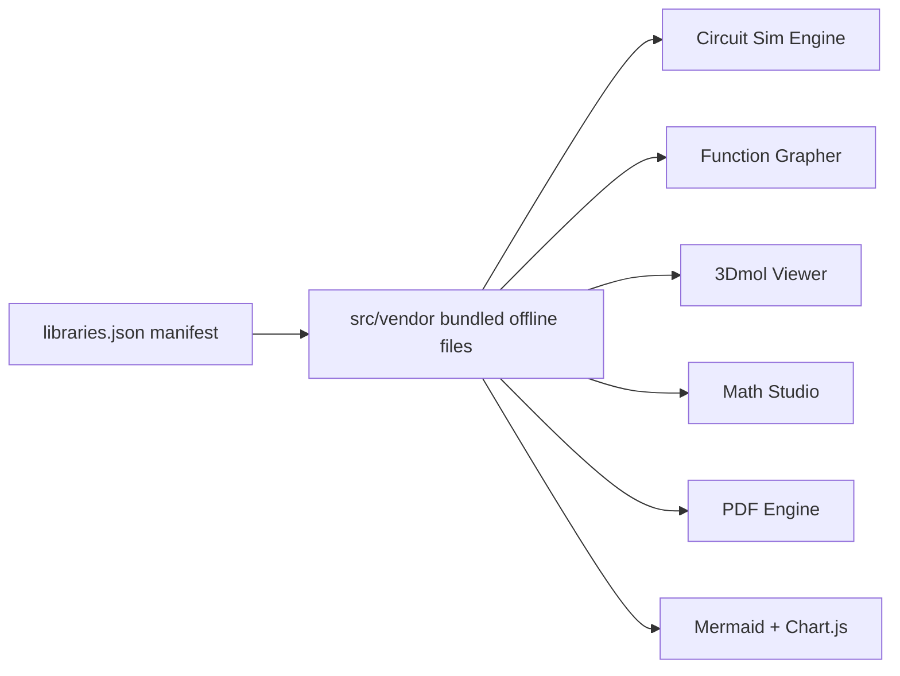
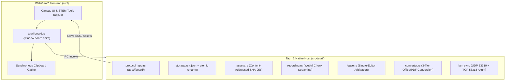

# System Architecture (`docs/ARCHITECTURE.md`)
> **1-Line Summary:** Plain-English visual map of how GaussBoard 6.9.2 works, why we chose each tool, and step-by-step recipes for adding new features.

## 1. High-Level Visual System Map

### [SUBSYSTEM: Dual-Runtime-Platform] | Aliases: Electron, PWA, web build, desktop app, window.board API
> **1-Line Summary:** One shared application logic runs as desktop Electron and as browser PWA through a single window.board platform contract.
* **How It Works (Plain English):** The renderer never talks to the OS directly. In Electron, preload exposes window.board via contextBridge with contextIsolation on. In the browser, web-storage, web-pdf, web-clipboard, and web-files adapters implement the same contract, with LibreOffice only in Electron.
* **Data Flow Diagram:**

* **Code Anchors (Grep Targets):**
  * `main.js` -> `createWindow`, `ipcMain.handle`, `appProtocol`
  * `preload.js` -> `contextBridge.exposeInMainWorld`, `window.board`
  * `src/js/platform/web-storage.js` -> `openBoard`, `saveBoard`
  * `src/js/platform/web-pdf.js` -> `renderPdfOffline`
  * `src/js/platform/web-adapter.js` -> `platformInfo`, `capabilities`

### [SUBSYSTEM: Document-Model-Op-Log] | Aliases: Store, doc.objects, operation log, undo, checkpoint, applyRemote
> **1-Line Summary:** Nothing mutates the document directly; every change is a sequenced operation that is applied, pushed to undo, and broadcast so sync needs no editor changes.
* **How It Works (Plain English):** Store owns doc.objects keyed by ID, doc.pages with margins, doc.audioTracks, doc.tags, and doc.aliases. Operations are add, del, set, order, and doc. checkpoint() snapshots full state and resets the log. applyRemote() replays peer ops with no undo entry and no echo.
* **Data Flow Diagram:**

* **Code Anchors (Grep Targets):**
  * `src/js/core/store.js` -> `Store`, `applyOp`, `checkpoint`, `applyRemote`, `onOp`
  * `src/js/core/pages.js` -> `pagesFrom`, `cleanPage`, `DATE_RE`
  * `src/js/core/markdown.js` -> `countTags`, `normalizeTextObject`
  * `src/js/core/util.js` -> `uid`, `unionBox`

### [SUBSYSTEM: Inking-Rendering] | Aliases: Canvas 2D, Bezier, DirectInk, pressure, background, culling
> **1-Line Summary:** Full-speed Canvas 2D with frozen base layer plus dynamic overlay, midpoint curves that never loop, and single-stroke rasterization.
* **How It Works (Plain English):** A stroke is one stroked path down its centerline curved through sample midpoints, staying inside its control triangle. Width is constant like felt pen; pressure sets stroke weight. Ink is stored exactly as captured, never thinned, and points keep p.t.
* **Data Flow Diagram:**

* **Code Anchors (Grep Targets):**
  * `src/js/core/ink.js` -> `InkEngine`, `fitBezier`, `preserveTime`
  * `src/js/core/render.js` -> `drawStroke`, `drawShape`, `drawCover`, `drawAudioCard`
  * `src/js/core/surface.js` -> `drawFrozen`, `drawReplaySession`, `firstPointAfter`
  * `src/js/core/recognize.js` -> `classifyInk`, `snapToShape`
  * `src/js/core/transform.js` -> `moveObject`, `scaleHandles`, `rotate`

### [SUBSYSTEM: Importers-Conversion] | Aliases: PDF.js, LibreOffice, mammoth, OOXML, pdf-lib, conversion hidden window
> **1-Line Summary:** Desktop conversion uses LibreOffice when installed and a hidden-window built-in fallback, while the browser renders PDFs offline with vendored PDF.js.
* **How It Works (Plain English):** Insert Document or drag-drop hands files to the converter. soffice --headless --convert-to pdf gives real layout. Without LibreOffice, mammoth and a small OOXML reader run in src/convert.html and print to PDF. All importers target the same page-picker contract.
* **Data Flow Diagram:**

* **Code Anchors (Grep Targets):**
  * `src/js/insert.js` -> `insertDocument`, `choosePages`
  * `src/js/importers/pdf.js` -> `rasterize`, `pdfjs-dist`
  * `src/js/importers/pptx.js` -> `readSlide`, `slideanim`
  * `src/js/importers/slidemedia.js` -> `extractMedia`
  * `soffice.js` -> `convertToPdf`, `LO_NOT_FOUND`
  * `msoffice.js` -> `builtinConvert`, `GAZBOARD_DISABLE_LIBREOFFICE`
  * `src/convert.html` -> `hiddenConvertWindow`

### [SUBSYSTEM: LAN-Sync-Transport] | Aliases: X25519, AES-256-GCM, discovery, pairing, firewall, sync-inbox
> **1-Line Summary:** Offline LAN handoff with no extra npm dependencies, using Node built-in crypto and explicit user acceptance before any board is saved.
* **How It Works (Plain English):** Discovery advertises on UDP 53319, transfers use TCP 53318 with fallback port. Pairing codes expire in 5 minutes after 5 attempts. Received boards show sender, name, size, and preview; Keep both or Replace, Escape declines, and replacing the open board reloads it.
* **Data Flow Diagram:**

* **Code Anchors (Grep Targets):**
  * `sync/protocol.js` -> `PROTOCOL`, `createPairingCode`, `sealMessage`, `openMessage`
  * `sync/node.js` -> `createTransport`, `listenForDiscovery`
  * `sync/firewall.js` -> `checkFirewall`, `repairWindowsRules`
  * `sync/desktop.js` -> `transferState`, `progress`

### [SUBSYSTEM: Five-Domain-Engines] | Aliases: circuit sim, grapher, 3Dmol, FSRS, WASM, vendor offline
> **1-Line Summary:** Pure-JavaScript STEM engines with zero native compilation and 15 vendored libraries resolved via libraries.json.
* **How It Works (Plain English):** Circuit MNA solves nodal equations with up to 12 propagation passes, driver nodes mutate in place, and DOL latch uses one contactor delay. Grapher guards domain/asymptote/zoom. FSRS schedules reviews. 3Dmol, function-plot, math.js, nerdamer, tesseract, pdfjs, mermaid, chart.js all load from src/vendor with no CDN.
* **Data Flow Diagram:**

* **Code Anchors (Grep Targets):**
  * `src/js/core/circuit-sim.js` -> `solveMNA`, `stepSim`, `armatureLatch`
  * `src/js/core/formula-graph.js` -> `parseFormula`, `tangentAt`, `riemannSum`
  * `src/js/core/scientific-math.js` -> `CAS`, `matrixDet`, `naturalMathToLaTeX`
  * `src/js/core/fsrs.js` -> `scheduleReview`, `exportClozeDeck`
  * `src/vendor/libraries.json` -> `manifestVersion`, `bundledPath`
  * `src/js/ui/library-inspector.js` -> `LibraryInspector`, `listVersions`

## 2. Tech Stack & Why We Chose It

| Layer | Tool / Library | Plain-English Reason Why |
| --- | --- | --- |
| Desktop host | Electron 43, electron-builder, electron-updater | Cross-platform Windows/macOS/Linux desktop with single JS codebase and in-app updates |
| UI rendering | Vanilla JS ES6 modules + HTML5 Canvas 2D | Zero framework overhead, fastest pen loop, no React/virtual DOM latency on ink |
| Inking math | Pure JS cubic Bezier + DirectInk pluggable | Pressure support with velocity-weighted smoothing and no native build step |
| Document model | Store + operation log (checkpoint/applyRemote) | Undo, replay, and future LAN sync share one seam with no editor rewrite |
| PDF import | pdfjs-dist 4.10.38 vendored, pdf-lib | Browser and desktop render the same PDF offline without server conversion |
| Office import | LibreOffice when present, mammoth + OOXML fallback | Real layout when possible, readable fallback when not, no cloud dependency |
| Math | KaTeX 0.16.21, nerdamer, math.js, function-plot | Offline TeX typesetting, CAS, and graphing with no runtime CDN |
| Media | mp4-muxer + WebCodecs/WebM | WebM keeps audio by default, MP4 is video-only with explicit notice |
| Sync crypto | Node built-in crypto X25519 + AES-256-GCM | No extra supply chain for room-scale handoff, offline by design |
| Android | Kotlin + Jetpack Compose under android/ | Native mobile board reuse with same storage and export contracts |
| Web | PWA service worker sw.js | Installable browser board that works offline after first load |

## 3. Core Subsystems & Engineering Tricks
See SUBSYSTEM sections above: Dual-Runtime-Platform, Document-Model-Op-Log, Inking-Rendering, Importers-Conversion, LAN-Sync-Transport, Five-Domain-Engines.

## 4. Verification & Health Checks

### [VERIFY: New-Features-Smoke] | Aliases: smoke, new-features, 24/24, CI smoke
> **1-Line Summary:** The active directive suite that must pass 24/24 before any change is called done.
* **Automated UI / Logic Verification:** `node scripts/smoke.js --new-features`

### [VERIFY: I18n-Parity-Check] | Aliases: i18n-check, translations, 2245 keys, 7 locales, lint
> **1-Line Summary:** Proves English keys match all 7 locales at 2,245/2,245 with zero missing strings.
* **Type & Lint Check:** `node scripts/i18n-check.js`

### [VERIFY: Full-Regression-Suite] | Aliases: smoke builtin, 1247 assertions, full suite, test:all
> **1-Line Summary:** Optional full base regression with 1,247 assertions, a known dynamic-t() scan failure in technical-linter, and a DOM requirement for video-framing.
* **Automated UI / Logic Verification:** `node scripts/smoke.js`
* **Focused Checks:** `node scripts/smoke.js --builtin`, `node scripts/smoke-custom.js`, `node --test test/p1-hardening.test.mjs`, `node --test test/video-framing.test.mjs`, `node scripts/smoke.js --features-4.8.4.1`

### [VERIFY: Portable-Exe-Packaging] | Aliases: electron-builder, portable exe, dist win, NSIS, cloud build
> **1-Line Summary:** Builds NSIS installer plus portable exe in CI; artifacts land in dist/ and attach to tag-triggered releases.
* **Portable `.exe` Packaging Command:** `npm run dist:win`
* **Other Targets:** `npm run dist:mac`, `npm run dist:linux`, `npm run build:web`

## 5. Recipes: How to Add New Things Safely
* **To add a new canvas tool:**
  1. Edit `src/js/core/tools.js` -> `toolStateMachine`
  2. Register palette in `src/js/ui/toolbar.js` -> `ribbon`
  3. Add render case in `src/js/core/render.js` -> `renderObject`
  4. Verify with `node scripts/smoke.js --new-features` and `node scripts/i18n-check.js`
* **To add a new STEM engine:**
  1. Keep it pure JS with no node-gyp dependency and check `src/js/core/ink.js` -> `preserveTime` style purity
  2. Vendor the library under `src/vendor/` and register it in `src/vendor/libraries.json` -> `bundledPath`
  3. Wire the card in `src/js/ui/sidebar-ribbon.js` -> `InsertMenu` with 1-click ribbon pinning
  4. Verify with `node scripts/smoke.js --new-features` and `node scripts/i18n-check.js`
* **To add a new locale:**
  1. Create `src/locales/<code>.json` with the English sentence as key
  2. Register in `src/js/i18n.js` -> `LANGUAGES`
  3. Verify with `node scripts/i18n-check.js`

## 6. Tauri 2 Rust Native Subsystem
### [SUBSYSTEM: Tauri-Rust-Native-Host] | Aliases: Tauri 2, Rust port, src-tauri, native backend
> **1-Line Summary:** Native, high-performance Rust backend replacing Electron main process with crash-safe storage, content-addressed assets, X25519 LAN sync, and native WebView2 print-to-pdf.
* **How It Works (Plain English):** The Tauri backend (`src-tauri/`) listens on the custom `app://board/` protocol scheme to serve Vanilla ES6 modules directly to the WebView2 frontend. The frontend adapter (`src/js/platform/tauri-board.js`) polyfills the `window.board` contract synchronously using Tauri 2 `invoke()` and cached clipboard signatures. Background tasks manage UDP discovery, Axum HTTP sync transport, and MS Office COM automation.
* **Architecture Diagram:**

* **Code Anchors (Grep Targets):**
  * `src/js/platform/tauri-board.js` -> `initTauriBridge`, `window.board`
  * `src-tauri/src/lib.rs` -> `run`, `tauri::Builder`, `invoke_handler`
  * `src-tauri/src/protocol_app.rs` -> `handle_app_protocol`
  * `src-tauri/src/storage.rs` -> `boards_save`, `atomic_write_bytes`
  * `src-tauri/src/lan_sync/mod.rs` -> `start_lan_sync_services`, `LanSyncManager`
