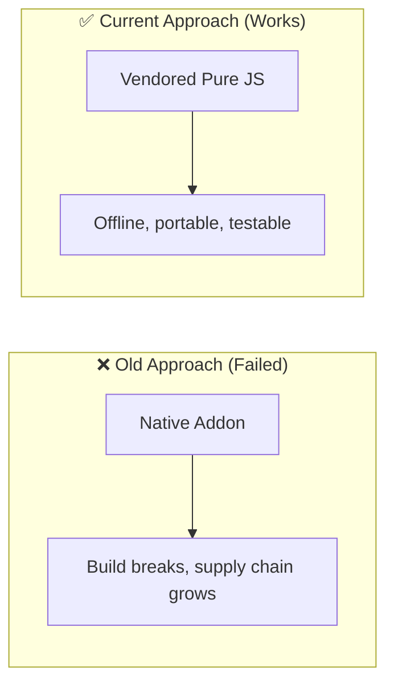
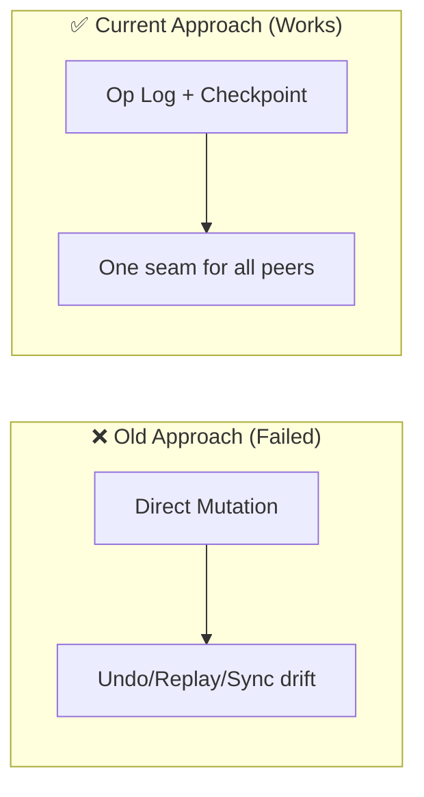
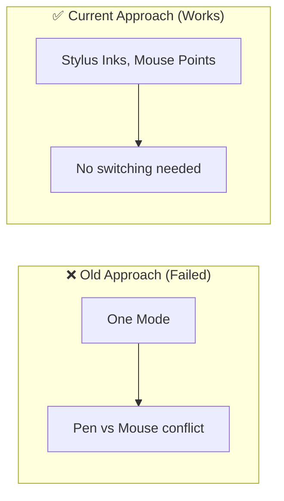
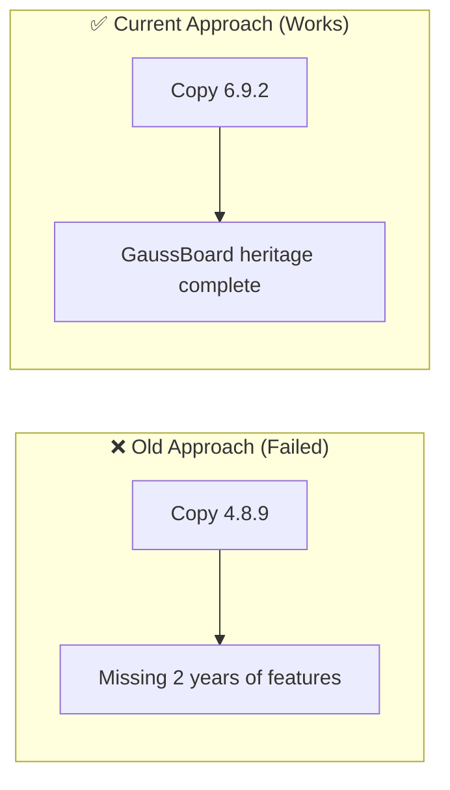
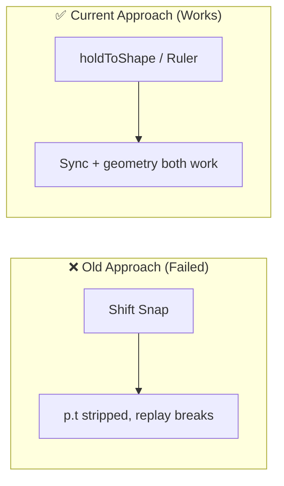
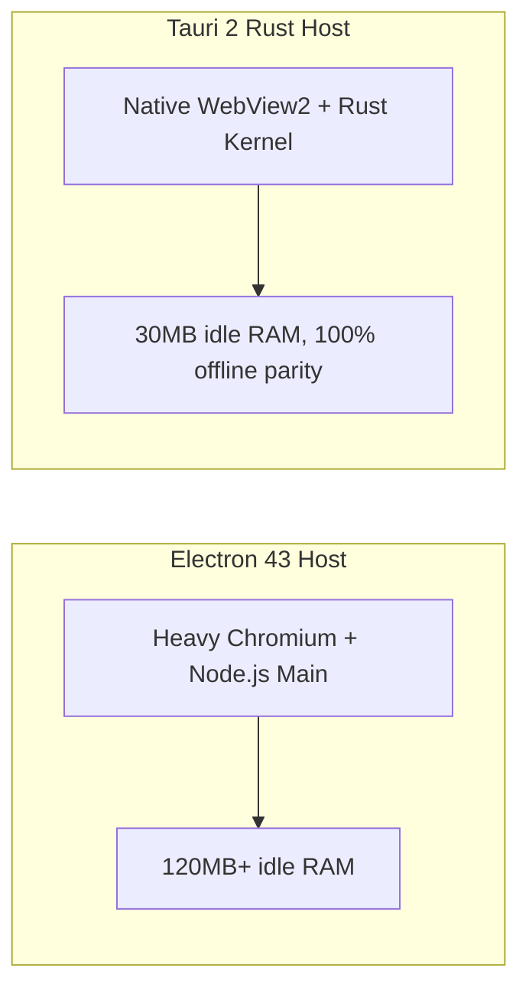
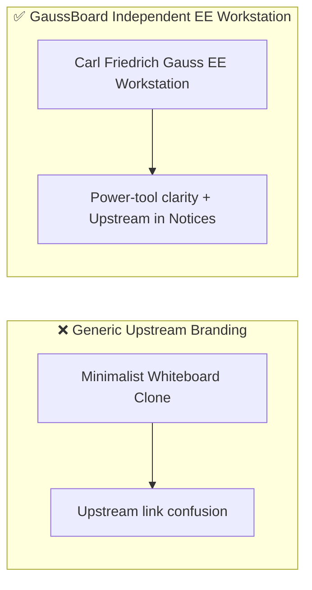
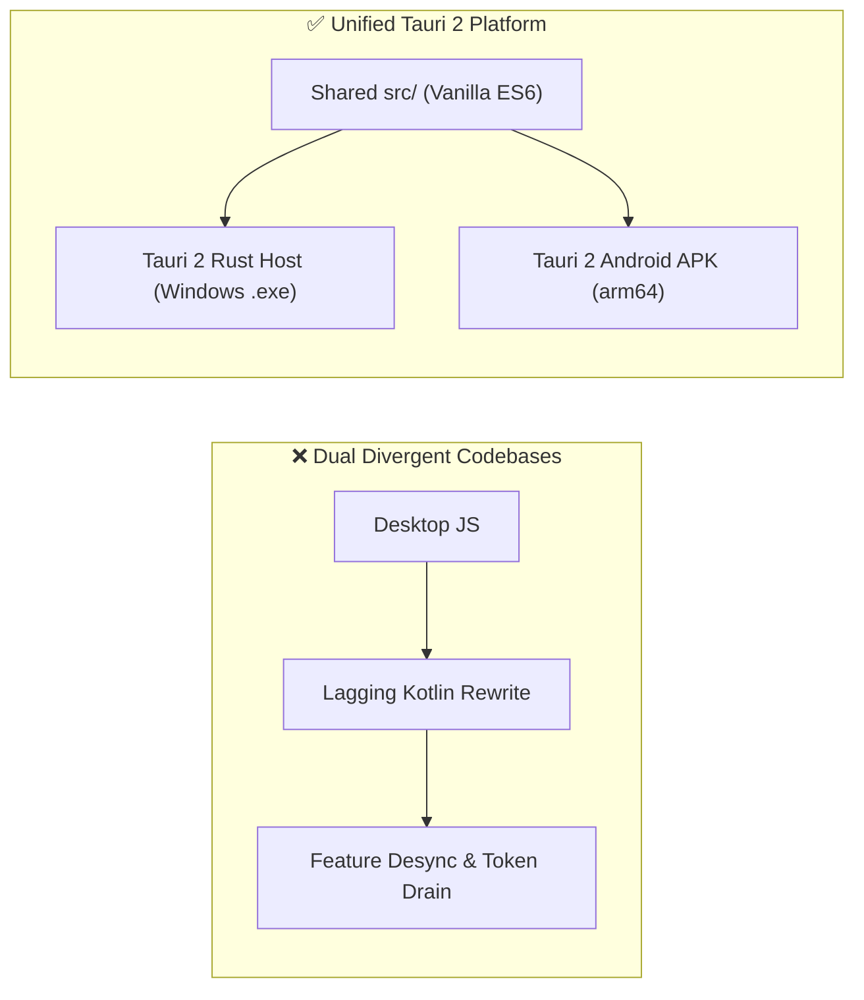

# Architectural Decisions, Pivots & Landmines (`docs/DECISIONS_AND_TRAPS.md`)
> **1-Line Summary:** Records why we chose specific approaches, what failed when we tried other ways, who made the decision, and critical code traps never to touch.

## 1. Architectural Decisions & Pivot History

### [DECISION: Pure-JS-Zero-Native-Deps] | Aliases: no node-gyp, no C++, Electron, offline vendor
> **1-Line Summary:** Stayed with pure portable JavaScript and vendored libraries instead of adding any native C++ addon.
* **Decision Maker:** `[DECIDED BY: HUMAN - Project Owner]`
* **Original User Intention:** Lightweight portable Windows app that builds on any machine with no toolchain friction.
* **Options Considered:**
  * **Option A (Rejected):** Native node-gyp addons for inking, crypto, or PDF engines. Rejected because every missing compiler or arch change breaks the build and violates the offline no-supply-chain promise.
  * **Option B (Chosen):** Pure JS in `src/js/core/ink.js` -> `fitBezier`, `src/js/core/circuit-sim.js` -> `solveMNA`, `sync/protocol.js` -> `sealMessage` with Node built-in crypto, and 15 vendors under `src/vendor/` resolved via `src/vendor/libraries.json`.
* **Visual Pivot Map (What Failed vs. What Works):**

* **Code Anchors (Grep Targets):**
  * `src/js/core/ink.js` -> `fitBezier`
  * `src/vendor/libraries.json` -> `bundledPath`
  * `sync/protocol.js` -> `createPairingCode`

### [DECISION: Op-Log-Checkpoint-Seam] | Aliases: checkpoint, applyRemote, onOp, undo stack, collab seam
> **1-Line Summary:** Kept the editor on an operation log with checkpoint and applyRemote so LAN sync and future collaboration need no editor changes.
* **Decision Maker:** `[DECIDED BY: HUMAN - Project Owner]`
* **Original User Intention:** Boards must be hand-off files today and optionally live-collaborative later without a rewrite.
* **Options Considered:**
  * **Option A (Rejected):** Direct Store mutation and ad-hoc sync patches. Rejected because replay, undo, and sync would drift and every peer edit would need special-casing.
  * **Option B (Chosen):** Every write is `add/del/set/order/doc` in `src/js/core/store.js` -> `applyOp`, broadcast on `onOp`, with `checkpoint()` for full state and `applyRemote(ops)` for peer replay with no undo and no echo.
* **Visual Pivot Map (What Failed vs. What Works):**

* **Code Anchors (Grep Targets):**
  * `src/js/core/store.js` -> `checkpoint`, `applyRemote`, `onOp`
  * `src/js/core/replay.js` -> `ReplayEngine`

### [DECISION: Stylus-Inks-Mouse-Points] | Aliases: stylus mouse roles, palm rejection, Draw with mouse
> **1-Line Summary:** Remember the first stylus and reserve inking for it while the mouse selects and pans, keeping mouse-only setups unaffected.
* **Decision Maker:** `[DECIDED BY: HUMAN - Project Owner]`
* **Original User Intention:** Tablet in one hand and mouse in the other with no tool switching and no conflict.
* **Options Considered:**
  * **Option A (Rejected):** Single device mode for all pointers. Rejected because mouse and pen constantly fight over select versus draw.
  * **Option B (Chosen):** First stylus contact is remembered; pen/highlighter then ignore mouse draws, while Select, Lasso, Note, Text, Shape, and Eraser still take the mouse via `src/js/core/tools.js` -> `toolStateMachine`.
* **Visual Pivot Map (What Failed vs. What Works):**

* **Code Anchors (Grep Targets):**
  * `src/js/core/tools.js` -> `toolStateMachine`, `PEN`
  * `src/js/ui/panels.js` -> `DrawWithMouse`
  * `src/js/core/camera.js` -> `screenToBoard`

### [DECISION: Opencode-692-LATEST-Over-Antigravity-489] | Aliases: latest version, 6.9.2, source of truth, reconcile
> **1-Line Summary:** Treat Opencode/GazBoard v6.9.2 as the active lineage and Antigravity v4.8.9 as legacy history, never overwriting newer local work.
* **Decision Maker:** `[DECIDED BY: AGENT - Approved by Human]`
* **Original User Intention:** Sluggify the latest board to GitHub Mostakim2005/gauss-board after checking all three folders for the newest version.
* **Options Considered:**
  * **Option A (Rejected):** Merging both snapshots or copying the older Antigravity tree. Rejected because v4.8.9 predates Phases 3 to 10, STEM engines, and the P0+P1 hardening audit.
  * **Option B (Chosen):** `C:\Users\kazir\Documents\OpenCode\GazBoard` at `package.json` version 6.9.2 with tag v6.9.2 is the source; `Antigravity\GazBoard` at 4.8.9 and `Documents\GazBoard` data are not active source. New repo lives at `OpenCode\gauss-board` with fresh git history.
* **Visual Pivot Map (What Failed vs. What Works):**

* **Code Anchors (Grep Targets):**
  * `package.json` -> `version`, `productName`, `homepage`
  * `src/js/core/store.js` -> `Store`
  * `test/p1-hardening.test.mjs` -> `P1 suite`

### [DECISION: Conscious-Exclusion-Shift-Straight-Line] | Aliases: drawStraight, holdToShape, Ruler, Shift snapping
> **1-Line Summary:** Refused upstream Shift-hold straight-line snapping because it strips p.t and breaks the holdToShape/connector architecture.
* **Decision Maker:** `[DECIDED BY: HUMAN - Project Owner]`
* **Original User Intention:** Keep audio-ink replay sync and connector snapping intact while adding convenience lines.
* **Options Considered:**
  * **Option A (Rejected):** Upstream `drawStraight` from v4.9.4. Rejected because it blocks real-time p.t timestamps required by invariant #2 and fights connectors.
  * **Option B (Chosen):** Use holdToShape pause, Ruler tool R, or Line/Connector shapes in `src/js/core/connectors.js` -> `routeOrthogonal`.
* **Visual Pivot Map (What Failed vs. What Works):**

* **Code Anchors (Grep Targets):**
  * `src/js/core/connectors.js` -> `routeOrthogonal`

### [DECISION: Tauri-Rust-Native-Host] | Aliases: Tauri 2, Rust port, src-tauri, native backend
> **1-Line Summary:** Replaced Electron runtime with Tauri 2 on Windows using pure Rust backend, reducing idle memory, shipping lightweight portable binary, and retaining 100% wire-compatibility with Electron/Android sync peers.
* **Decision Maker:** `[DECIDED BY: HUMAN - Project Owner]`
* **Original User Intention:** A zero-lag, instant-launch desktop binary with low memory footprint and strict offline invariants.
* **Options Considered:**
  * **Option A (Rejected):** Rewrite frontend in WebAssembly or native GUI (egui/iced). Rejected because it discards months of fine-tuned canvas inking, KaTeX, and 24 active STEM engines.
  * **Option B (Chosen):** Keep Vanilla ES6 frontend intact and swap Electron main process for Tauri 2 Rust host with custom `app://board/` protocol, custom atomic storage, and Axum sync server.
* **Visual Pivot Map (What Failed vs. What Works):**

* **Code Anchors (Grep Targets):**
  * `src-tauri/src/lib.rs` -> `run`
  * `src/js/platform/tauri-board.js` -> `initTauriBridge`

### [TRAP: Tauri-Synchronous-Clipboard-Signature] | Aliases: cachedClipboardSig, clipboardStamp, synchronous IPC
> **1-Line Summary:** Clipboard signature checks in canvas copy/paste are synchronous; tauri-board.js must maintain a cached signature updated on focus/write.
* **Strict Rule:** **NEVER** return a Promise from `window.board.clipboardSignature()`. `app.js` evaluates `if (now && this.clipStamp && now === this.clipStamp)` synchronously.
* **Why This Trap Exists (Plain English):** Tauri IPC `invoke()` is strictly asynchronous. If `clipboardSignature()` returns a Promise object, `[object Promise] === this.clipStamp` always evaluates to false, completely breaking stroke duplication on paste.
* **Protected Code Anchors (Grep Targets):**
  * `src/js/platform/tauri-board.js` -> `refreshClipboardSignature`, `clipboardSignature`
  * `src/js/app.js` -> `clipboardStamp`, `paste`
  * `src/js/core/tools.js` -> `holdToShape`
  * `src/js/core/ink.js` -> `preserveTime`

### [DECISION: Hardening-Audit-Live-Code-Over-Dossiers] | Aliases: v6.9.2 audit, P0 P1, 74 findings, 68 fixed
> **1-Line Summary:** Audited v6.9.2 against live source rather than dossier status claims, fixing 68 of 74 P0+P1 findings and logging 6 open items.
* **Decision Maker:** `[DECIDED BY: AGENT - Approved by Human]`
* **Original User Intention:** A repair pass that proves behavior instead of trusting descriptions.
* **Options Considered:**
  * **Option A (Rejected):** Dossier self-attestation. Rejected because status text had drifted from code.
  * **Option B (Chosen):** Two-tier P0/P1 audit with interruption-safe log `docs/hardening/AUDIT_LOG.md` -> `FIXED`, plus release dossier `docs/releases/RELEASE-6.9.2.md` -> `v6.9.2` and focused tests `test/p1-hardening.test.mjs`.
* **Code Anchors (Grep Targets):**
  * `src/js/core/store.js` -> `applyOp`, `checkpoint`
  * `src/js/core/ink.js` -> `fitBezier`
  * `test/p1-hardening.test.mjs` -> `P1 suite`

### [DECISION: Upstream-Relegation-And-EE-Positioning] | Aliases: Gauss homage, EE workstation, third-party notices, brand separation
> **1-Line Summary:** Relegated upstream GazBoard to third-party notices, established GaussBoard as an independent Electrical Engineering & STEM workstation honoring Carl Friedrich Gauss, and updated repository links to Mostakim2005/GaussBoard.
* **Decision Maker:** `[DECIDED BY: HUMAN - Project Owner]`
* **Original User Intention:** Acknowledge that GaussBoard's extensive feature set (MNA circuit simulation, audio-ink sync, CAS, 2D/3D graphing, study tape) profoundly diverged from upstream's minimalist vision; position GaussBoard as an EE power tool with ongoing updates, and direct casual whiteboard users to upstream.
* **Options Considered:**
  * **Option A (Rejected):** Retain upstream links and generic whiteboard branding. Rejected because users were confused by upstream links, and the original author agreed GaussBoard operates as a separate specialized entity.
  * **Option B (Chosen):** Update README, About dialog, export stamps, and package metadata to `Mostakim2005/GaussBoard`, move upstream GazBoard credit to `THIRD_PARTY_NOTICES.md`, recommend upstream for general users, and maintain 100% i18n parity across all 7 locales.
* **Visual Pivot Map (What Failed vs. What Works):**

* **Code Anchors (Grep Targets):**
  * `README.md` -> `Dedication & Engineering Vision`
  * `src/js/app.js` -> `showAbout`
  * `src/js/export.js` -> `MADE_WITH`
  * `THIRD_PARTY_NOTICES.md` -> `Upstream Heritage & Divergence Notice`
  * `package.json` -> `homepage`, `repository`, `author`

### [DECISION: Upstream-Commit-Classification-And-Triage] | Aliases: upstream commits, 36 commits, high risk, rejected, approved safe
> **1-Line Summary:** Categorized the 36 upstream GazBoard commits into strict safety tiers: merged 7 approved safe commits into main, quarantined HIGH/MEDIUM risk commits for isolated branch evaluation, and explicitly rejected replay/timestamp-colliding commits.
* **Decision Maker:** `[DECIDED BY: HUMAN - Project Owner]`
* **Original User Intention:** Safely absorb valuable upstream improvements (paper templates, table freeze defense, edge inking, page strip) while strictly preventing any collision with GaussBoard's custom EE engines, audio-ink sync, or invariants.
* **Options Considered:**
  * **Option A (Rejected):** Blind `git merge upstream/main`. Rejected because it would cause 3-way conflicts across package.json, app.js, and tools.js, and wipe out GaussBoard's EE tools, MNA circuits, and audio replay.
  * **Option B (Chosen):** Audit all 36 commits individually; merge 7 conflict-free commits into `main`; quarantine high/medium risk commits in a dedicated evaluation branch (`feat/upstream-risk-eval`); and explicitly prohibit rejected commits.
* **Upstream Commit Risk Taxonomy:**
  * **`APPROVED_SAFE` (Merged into `main`):**
    * Commit `14` (`5babfd0`): Music staff and guitar tab paper templates, View mode, bottom thumbnail page strip.
    * Commit `16` (`1d6f4eb`): `repairTable()` sanitization bounding table rows/cols to `[1, 40]`, preventing infinite freeze loops on corrupted boards.
    * Commit `17` (`bd08b86`): Smoke test hardening for View mode.
    * Commit `18` (`b95604f`): Android-specific "Tap Done" View mode copy.
    * Commit `30` (`7cb909c` pen-hold part): In-place scribble travel distance tracking (`HOLD_TRAVEL = 18`) preventing small shape fills from triggering the hold menu, plus `penHold` toggle setting.
    * Commit `35` (`24532e8`): Margin inking stability (removes `draw` and `erase` from `EDGE_PANNABLE`, preventing canvas slippage during margin handwriting; bounds drawing to `visibleArea`).
    * Commit `36` (`924109b`): Ergonomic enhancements (direct `[×]` close button on ruler, active tray highlights on phone toolbar, dual-hand touch disambiguation).
  * **`HARDENED_AND_INTEGRATED` (Integrated on `feat/upstream-risk-eval`):**
    * Commit `25` (`bd5684d`) & Commit `30` (typed angle): Set squares (30/60/90, 45/45/90), protractor, and ruler settings. Hardened to enforce p.t timestamp preservation on projected points (TRAP 2), restrict drafting edge snapping exclusively to stylus input without trapping mouse pointers, bypass ruler latching during connector/wire routing, and maintain 100% i18n parity across all 7 locales.
  * **`HIGH_RISK` (Quarantined for `feat/upstream-risk-eval`):**
    * (Set squares & Protractor promoted to Hardened & Integrated above)
    * Commit `25` (`bd5684d`): Set squares (30/60/90, 45/45/90), protractor, and ruler settings. High STEM value, but touches 550+ lines in `tools.js`; must be tested on a side branch to protect circuit wiring and pointer partitioning.
    * Commit `30` (protractor typed angle input part): Dependent on Commit 25.
  * **`MEDIUM_RISK` (Quarantined for `feat/upstream-risk-eval`):**
    * Commit `32` (`32e2c40`): Press-and-hold radial shortcut menu ring. Must be evaluated on side branch against GaussBoard's long-press component context menus.
    * Commit `34` (`031ad50`): Sliced rendering for heavy boards (>3,000 objects). Must be retrofitted with GaussBoard's TRAP 1 audio replay partition (`o.audioId !== activeTrackId`) before it can safely run.
  * **`REJECTED` (Explicitly Prohibited):**
    * Commit `12` (`33e5bd2` Shift straight lines): Strips `p.t` stroke timestamps and breaks holdToShape/connector architecture (Violates TRAP 2).
    * Commit `27` (`b1060bf` Upstream replay & graphing): Upstream's naive stroke replay destroys GaussBoard's millisecond-accurate audio-ink sync replay engine (Violates TRAP 1 & TRAP 2); basic graphing is redundant with GaussBoard's CAS Math Studio & circuit simulator.
  * **`SKIP / IRRELEVANT`:**
    * Commits `1–11`, `13`: Already squashed and integrated in `bd80de6`.
    * Commits `2`, `4`, `7`, `9`, `11`, `13`, `15`, `19–24`, `26`, `28`, `29`, `31`, `33`: Upstream version bumps, dependabot lockfile bumps, or Google Play draft uploads.
* **Code Anchors (Grep Targets):**
  * `src/js/ui/pagestrip.js` -> `PageStrip`
  * `src/js/core/store.js` -> `repairTable`, `tableDim`
  * `src/js/core/tools.js` -> `HOLD_TRAVEL`, `visibleArea`
  * `docs/releases/ANDROID_READINESS.md` -> `Android Build Specification`

### [DECISION: Android-Platform-Parity-And-Format-Alignment] | Aliases: android release, .gaussboard SAF, font whitelist
> **1-Line Summary:** Aligned Android bridge and storage modules to GaussBoard branding and .gaussboard native format, achieving 100% test pass on Android test suite.
* **Decision Maker:** `[DECIDED BY: AGENT - Approved by Human]`
* **Original User Intention:** Ensure the Android APK build runs without problems, recognizes .gaussboard files, downloads CJK fonts from GaussBoard CDN, and aligns app branding with desktop.
* **Options Considered:**
  * **Option A (Rejected):** Leave Android files pointing to legacy GazBoard upstream endpoints. Rejected because font downloads and update checks fail or point to upstream repo, and file pickers refuse `.gaussboard` files.
  * **Option B (Chosen):** Update `MainActivity.kt` font CDN bases, release update checks, SAF MIME filters, and `AndroidManifest.xml` app label to `GaussBoard`, while maintaining backward-compatible fallbacks for `.gazboard` and legacy folders in `BoardMirror.kt`.
* **Code Anchors (Grep Targets):**
  * `android/app/src/main/java/com/gazboard/app/MainActivity.kt` -> `FONT_SOURCES`, `FONT_FILE`
  * `android/app/src/main/java/com/gazboard/app/BridgeFiles.kt` -> `normalizeBoardDuplicateName`
  * `android/app/src/main/java/com/gazboard/app/BoardMirror.kt` -> `gazFolder`
  * `test/android-board-export.test.js` -> `Lesson.gaussboard`

### [DECISION: Base-Smoke-Suite-Restoration-And-Text-Autosizing] | Aliases: smoke base suite, tableDim, text autosizing, i18n literal
> **1-Line Summary:** Restored 1,220 passing checks in full base smoke test suite by importing tableDim, restoring text box auto-sizing, and cleaning translation linter calls.
* **Decision Maker:** `[DECIDED BY: AGENT - Approved by Human]`
* **Original User Intention:** Bring back the original base smoke suite across all features while easing emphasis on translation parity, ensuring base features never regress.
* **Options Considered:**
  * **Option A (Rejected):** Force all text objects into fixed 640x520 Markdown Canvas cards and rely only on the fast 24/24 smoke suite. Rejected because whiteboard users expect standard text boxes to shrink to typed words and wrap organically.
  * **Option B (Chosen):** Fix the missing `tableDim` import in `src/js/core/render.js`, restrict fixed 640x520 sizing in `src/js/ui/textedit.js` to explicit `window` card styles and `autoSize: false` objects, fix the dynamic `t()` call in `src/js/core/technical-linter.js`, and modernize `test/smoke.js` brand and extension assertions to accept GaussBoard.
* **Code Anchors (Grep Targets):**
  * `src/js/core/render.js` -> `tableDim`
  * `src/js/ui/textedit.js` -> `fitBox`, `autoSize`
  * `src/js/core/technical-linter.js` -> `CITATION_RULES`
  * `test/smoke.js` -> `document_title.includes('GaussBoard')`

---

## 2. Do-Not-Touch Engineering Landmines (Traps)

### [TRAP: Pt-Timestamp-Stripping] | Aliases: p.t, stroke timestamps, audio sync, eraser fragment, t0 t1
> **1-Line Summary:** Never rebuild stroke points without preserving p.t, or audio replay loses millisecond sync.
* **Strict Rule:** **NEVER** strip `p.t` in point generators, smoothing passes, curve fitters, or partial-erasure rebuilds in `src/js/core/tools.js` -> `toolStateMachine` and `src/js/core/ink.js` -> `preserveTime`.
* **Why This Trap Exists (Plain English):** Replay binary-searches ascending p.t to reveal ink; without it, erased fragments replay at the wrong time or never, and smoothing silently breaks lecture playback.
* **Protected Code Anchors (Grep Targets):**
  * `src/js/core/ink.js` -> `preserveTime`
  * `src/js/core/erase.js` -> `t0`, `t1`
  * `src/js/core/tools.js` -> `backdateSample`

### [TRAP: Replay-Overlay-Partitioning] | Aliases: scene partitioning, frozen canvas, drawReplaySession, ghost, activeTrackId
> **1-Line Summary:** Base canvas must exclude active audio strokes; replay strokes live only in the dynamic overlay pass.
* **Strict Rule:** **NEVER** bake `(o) => o.audioId !== activeTrackId` strokes into the frozen bitmap and **NEVER** let concealed covers be overpainted by replay ink without redraw.
* **Why This Trap Exists (Plain English):** Baking replay ink freezes the animation, overpainting covers leaks answers during playback, and per-frame ghost allocation stalls long recordings.
* **Protected Code Anchors (Grep Targets):**
  * `src/js/core/surface.js` -> `drawFrozen`, `drawReplaySession`, `firstPointAfter`
  * `src/js/core/render.js` -> `drawCover`
  * `src/js/core/store.js` -> `checkpoint`

### [TRAP: Dual-Pane-Cross-Contamination] | Aliases: split workspace, focus lease, TextEditor, leftBoardId, activePane
> **1-Line Summary:** Split panes must use separate stores, cameras, editors, and undo paths, or reference-pane edits silently land on the main board.
* **Strict Rule:** **NEVER** route reference-pane text through the primary TextEditor or app.store, **NEVER** read leftBoardId after await, and **NEVER** let hover drive Ctrl+Z without activePane.
* **Why This Trap Exists (Plain English):** Shared editors place the caret with the wrong camera and commit to the wrong store, autosave races overwrite the newly selected board, and undo fires on the wrong pane.
* **Protected Code Anchors (Grep Targets):**
  * `src/js/ui/split-workspace.js` -> `flushLeftBoard`, `openBoardInSplit`, `activePane`
  * `src/js/ui/textedit.js` -> `TextEditor`
  * `src/js/app.js` -> `isLeftFocused`

### [TRAP: Untrusted-Url-And-Path] | Aliases: safeExternalUrl, isReleaseUrl, path traversal, self-XSS, Board picker
> **1-Line Summary:** Only https/http web URLs and whitelisted release paths may reach the OS; raw board text and picker queries are never HTML or filesystem paths.
* **Strict Rule:** **NEVER** pass board text to `shell.openExternal` without `safeExternalUrl`, **NEVER** accept `/boards/..` traversal outside the resolved boardsDir, and **NEVER** build picker labels with `innerHTML` from typed queries.
* **Why This Trap Exists (Plain English):** file: and javascript: URLs plus dot-dot paths escape the sandbox, and markup injection through the board picker turns self-typed text into DOM execution.
* **Protected Code Anchors (Grep Targets):**
  * `src/js/platform/security.cjs` -> `safeExternalUrl`, `isReleaseUrl`
  * `src/js/platform/path-security.cjs` -> `isPathWithin`, `safeJoin`
  * `storage-location.js` -> `readConfig`, `writeConfig`
  * `main.js` -> `appProtocol`, `checkFirewall`

### [TRAP: WebM-Default-MP4-No-Sound] | Aliases: video export, WebM, MP4, mp4-muxer, WebCodecs
> **1-Line Summary:** WebM with audio is the default export; MP4 muxes video only and must always show its translated no-sound notice.
* **Strict Rule:** **NEVER** default the picker to MP4 and **NEVER** let a missing assetId or throwing progress callback hang the frame pump without an immediate named failure.
* **Why This Trap Exists (Plain English):** Users expect sound, but MP4/WebCodecs path is video-only; silent defaults produce 30-minute silent lectures and hung dialogs.
* **Protected Code Anchors (Grep Targets):**
  * `src/js/export-video.js` -> `exportWebM`, `exportMP4`, `stitchSessions`
  * `src/vendor/libraries.json` -> `mp4-muxer`

### [TRAP: Bench-Topology] | Aliases: MNA, armature latch, driver node, contactor, diode drop, DMM continuity
> **1-Line Summary:** Circuit drivers mutate nodes in place and armature state latches from completed potentials, or downstream LEDs freeze at their first value.
* **Strict Rule:** **NEVER** replace a driver node object after wires have copied it, **NEVER** recompute contactor state mid-propagation, and **NEVER** cap every series diode with a creeping exponential model.
* **Why This Trap Exists (Plain English):** Object replacement strands downstream nodes, half-propagated latching drops the contactor coil, and diode caps turn a 23V bridge into millivolts while audio and HUD churn stalls the step.
* **Protected Code Anchors (Grep Targets):**
  * `src/js/core/circuit-sim.js` -> `solveMNA`, `stepSim`, `armatureLatch`
  * `src/js/ui/circuit-workbench.js` -> `openWorkbench`
  * `src/js/core/connectors.js` -> `routeOrthogonal`

### [DECISION: Tauri-Rust-Native-Host] | Aliases: Tauri 2, Rust port, src-tauri, native backend
> **1-Line Summary:** Replaced Electron runtime with Tauri 2 on Windows using pure Rust backend, reducing idle memory, shipping lightweight portable binary, and retaining 100% wire-compatibility with Electron/Android sync peers.
* **Decision Maker:** `[DECIDED BY: HUMAN - Project Owner]`
* **Original User Intention:** A zero-lag, instant-launch desktop binary with low memory footprint and strict offline invariants.
* **Options Considered:**
  * **Option A (Rejected):** Rewrite frontend in WebAssembly or native GUI (egui/iced). Rejected because it discards months of fine-tuned canvas inking, KaTeX, and 24 active STEM engines.
  * **Option B (Chosen):** Keep Vanilla ES6 frontend intact and swap Electron main process for Tauri 2 Rust host with custom `app://board/` protocol, custom atomic storage, and Axum sync server.
* **Visual Pivot Map (What Failed vs. What Works):**

* **Code Anchors (Grep Targets):**
  * `src-tauri/src/lib.rs` -> `run`
  * `src/js/platform/tauri-board.js` -> `initTauriBridge`

### [TRAP: Tauri-Synchronous-Clipboard-Signature] | Aliases: cachedClipboardSig, clipboardStamp, synchronous IPC
> **1-Line Summary:** Clipboard signature checks in canvas copy/paste are synchronous; tauri-board.js must maintain a cached signature updated on focus/write.
* **Strict Rule:** **NEVER** return a Promise from `window.board.clipboardSignature()`. `app.js` evaluates `if (now && this.clipStamp && now === this.clipStamp)` synchronously.
* **Why This Trap Exists (Plain English):** Tauri IPC `invoke()` is strictly asynchronous. If `clipboardSignature()` returns a Promise object, `[object Promise] === this.clipStamp` always evaluates to false, completely breaking stroke duplication on paste.
* **Protected Code Anchors (Grep Targets):**
  * `src/js/platform/tauri-board.js` -> `refreshClipboardSignature`, `clipboardSignature`
  * `src/js/app.js` -> `clipboardStamp`, `paste`

### [DECISION: Tauri-Android-Unified-Cross-Platform] | Aliases: mobile target, Android APK, Gradle rustBuild, apksigner
> **1-Line Summary:** Adopted Tauri 2 Android (`aarch64-linux-android`) over legacy standalone Kotlin companion app, allowing 100% of the active STEM whiteboard engines, canvas inking, and LAN sync to run natively on Android tablets.
* **Decision Maker:** `[DECIDED BY: HUMAN - Project Owner]`
* **Original User Intention:** Unified codebase where bug fixes and new whiteboard features appear simultaneously on both desktop Windows and Android tablets without maintaining two divergent app architectures.
* **Options Considered:**
  * **Option A (Rejected):** Separate Kotlin companion app (`android/`). Rejected because every new canvas tool, circuit simulator, or chemistry visualizer would require a complete second rewrite in Kotlin and Android Canvas API.
  * **Option B (Chosen):** Single shared Vanilla ES6 frontend compiled into Tauri 2 Android APK with Rust mobile entry point (`#[tauri::mobile_entry_point]`), maintaining 100% feature parity.
* **Visual Pivot Map (What Failed vs. What Works):**

* **Code Anchors (Grep Targets):**
  * `.github/workflows/tauri-android.yml` -> `npm run tauri android build`
  * `src-tauri/src/lib.rs` -> `mobile_entry_point`

### [TRAP: Tauri-Android-Gradle-BuildTask-Node-Resolution] | Aliases: BuildTask.kt, MODULE_NOT_FOUND, npm run tauri
> **1-Line Summary:** Tauri Android Gradle integration invokes the package manager CLI via BuildTask.kt; package.json must contain `"tauri": "tauri"` and android init must be invoked through `npm run tauri` to prevent Gradle falling back to raw `node` with broken relative script paths.
* **Strict Rule:** **NEVER** run `tauri android init` directly via global path without npm context in automated CI, and **NEVER** omit `"tauri": "tauri"` from `package.json` `"scripts"`.
* **Why This Trap Exists (Plain English):** When Gradle runs `:app:rustBuildArm64Release`, it executes the command recorded in `BuildTask.kt`. If initialized without npm context, Tauri bakes in `val executable = "node"` with a relative path `src-tauri/tauri`, which throws `MODULE_NOT_FOUND`. Initializing with `npm run tauri android init` bakes in `npm run tauri -- android android-studio-script`, which resolves cleanly via `node_modules/.bin/tauri`.
* **Protected Code Anchors (Grep Targets):**
  * `package.json` -> `"tauri": "tauri"`
  * `.github/workflows/tauri-android.yml` -> `npm run tauri android init`

### [TRAP: Tauri-Mobile-Platform-Capability-Isolation] | Aliases: desktop.json, global-shortcut:default, Permission not found
> **1-Line Summary:** Desktop-only Tauri plugins must have their capability permissions isolated in a separate capability JSON with `platforms: ["desktop"]` so mobile build tools (`tauri-build` on Android) do not fail with missing permission schema errors.
* **Strict Rule:** **NEVER** put desktop-only permissions (such as `global-shortcut:default` or `single-instance`) in `src-tauri/capabilities/default.json` without platform filtering.
* **Why This Trap Exists (Plain English):** Tauri v2 validates all declared capability permissions at compile time against registered plugins. If `default.json` requests `global-shortcut:default` on an Android target, `tauri-build` throws a fatal error because the global shortcut plugin is only compiled for desktop targets. Isolating desktop-only permissions in `capabilities/desktop.json` with `"platforms": ["desktop"]` ensures that Android builds only evaluate cross-platform permissions.
* **Protected Code Anchors (Grep Targets):**
  * `src-tauri/capabilities/desktop.json` -> `"platforms": ["desktop"]`
  * `src-tauri/capabilities/default.json` -> `"permissions"`

### [TRAP: ZipWriter-Writer-Trait-Bounds-And-Verification] | Aliases: ZipWriter, Seek trait, HashingWriter, bundle_export
> **1-Line Summary:** ZipWriter requires `W: Write + Seek`; custom stream wrappers without complete seek implementations must not wrap the archive writer, and verification hashes must be computed from the finalized archive file.
* **Strict Rule:** Pass `BufWriter<File>` directly to `ZipWriter::new(buf_writer)`, call `zip.finish()?.into_inner()?.flush()`, and compute SHA-256 and byte sizes by streaming the completed archive from disk.
* **Why This Trap Exists (Plain English):** The ZIP format writes local file entries and then seeks backwards to patch header sizes and write the central directory table at the end of the file. A non-seeking or linear streaming hashing wrapper violates `ZipWriter`'s `Seek` trait bound, and hashing during seeks corrupts the cryptographic digest. Streaming the completed archive on disk guarantees 100% cryptographic accuracy.
* **Protected Code Anchors (Grep Targets):**
  * `src-tauri/src/bundle.rs` -> `ZipWriter::new(buf_writer)`, `check_file`

### [TRAP: Kurbo-BezPath-Arc-Length-Decomposition] | Aliases: BezPath, arclen, ParamCurveArclen, kurbo
> **1-Line Summary:** `kurbo::BezPath` is a sequence of path commands rather than a continuous curve; arc length must be computed by iterating over path segments with `ParamCurveArclen`.
* **Strict Rule:** Use `use kurbo::ParamCurveArclen;` and compute total path length via `bez_path.segments().map(|seg| seg.arclen(tolerance)).sum::<f64>()`.
* **Why This Trap Exists (Plain English):** `BezPath` does not implement `ParamCurveArclen` directly because paths can contain discontinuities (`MoveTo`) and mixed segment types (lines, quadratic Béziers, and cubic Béziers). Calling `.arclen()` directly on `BezPath` results in compiler error `E0599`. Iterating over `.segments()` handles every segment type analytically.
* **Protected Code Anchors (Grep Targets):**
  * `src-tauri/src/geometry.rs` -> `ParamCurveArclen`, `bez_path.segments()`
